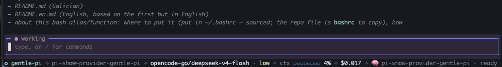

# pi-show-provider-gentle-pi

[English version →](README.en.md)

Parchea a barra inferior de **gentle-pi** (a shell de [Pi](https://pi-coding.com)) para que amose `provider / model` en lugar de só `model`. Faino editando directamente o ficheiro de orixe do core: `extensions/gentle-shell.ts`.



## 🚀 Uso

Instala o paquete (local, git ou npm) e reinicia Pi:

```bash
pi install ./pi-show-provider-gentle-pi        # ou git:/npm:
```

Dentro de Pi executa:

```bash
/show-provider-gentle-pi on     # parchea: a barra amosa "provider / model"
/show-provider-gentle-pi off    # reverte: a barra volve a amosar só "model"
```

## 🔧 Por que un parche do core?

A barra inferior constrúe o identificador do modelo en `buildShellBarModel()`, dentro de `extensions/gentle-shell.ts`:

```ts
// orixinal
	modelId: model?.id ?? "no-model",
```

O parche substitúe ese fragmento por:

```ts
// despois do parche
	modelId: model ? `${model.provider}/${model.id}` : "no-model",
```

Mentres gentle-pi monte `modelId` no propio core, unha extensión externa non pode alteralo: esta extensión é a que fai o cambio físico no ficheiro, coma o alias de shell que creabas antes.

## ✅ Comportamento

- **`/show-provider-gentle-pi on`** — Fai primeiro unha copia de seguridade con selo de tempo (`gentle-shell.ts.YYYYMMDDHHMMSS`) e despois aplica o parche. Está protexido contra sobreescritura: **se o ficheiro xa está parcheado, non toca nada** e avisa.
- **`/show-provider-gentle-pi off`** — Reverte o parche editando o propio ficheiro (non restaura o backup, así non o perdes aínda que o backup sexa dunha versión vella de gentle-pi). Está protexido contra sobreescritura: **se o ficheiro xa está restaurado, non toca nada** e avisa.
- Traballa igual en **macOS e Linux** (non depende do `sed` de BSD/GNU).

## 💾 Backup

- **Onde**: na mesma carpeta que o ficheiro orixinal.
- **Formato**: `gentle-shell.ts.YYYYMMDDHHMMSS`, co selo de tempo do momento do `/show-provider-gentle-pi on` (exemplo: `gentle-shell.ts.20260912012624`).

Listar os backups:

```bash
ls -la ~/.pi/agent/npm/node_modules/gentle-pi/extensions/gentle-shell.ts.*
```

## ⚙️ Detalles

- **Detección de estado**: mira o **campo `modelId` completo**, non unha cadea solta nin un nome de método. Se contén `modelId: model ? \`${model.provider}/${model.id}\` : "no-model"` está acendido; se contén `modelId: model?.id ?? "no-model"` está apagado. Se non recoñece ningún dos dous, avisa e non toca nada (seguridade).
  Isto é deliberado: en versións recentes de gentle-pi a cadea `${model.provider}/${model.id}` tamén aparece noutros puntos do ficheiro (por exemplo, na clave de *adaptive reasoning*). Unha detección por cadea solta daría sempre «xa parcheado» e o interruptor nunca actuaría, por iso se ancorou ao campo `modelId`.
- **Camiño do ficheiro** (orde de precedencia):
  1. variable de contorno `PI_SHOW_PROVIDER_GENTLE_PI_TARGET`;
  2. resolución como paquete irmán dentro do mesmo `node_modules` (funciona en instalacións globais e de proxecto);
  3. predeterminado: `~/.pi/agent/npm/node_modules/gentle-pi/extensions/gentle-shell.ts`.
- Ao actualizar ou reinstalar gentle-pi, o ficheiro volve ao estado orixinal e haberá que executar `/show-provider-gentle-pi on` de novo.

## 🧪 Proba

```bash
npm test
```

Corre 7 test sobre os helpers puros con copias temporais do ficheiro — **nunca toca** a instalación real de gentle-pi.

## 📂 Contido do repo

| Ficheiro | Descrición |
| --- | --- |
| `extensions/show-provider.ts` | A extensión de Pi que rexistra `/show-provider-gentle-pi on/off`. |
| `tests/show-provider.test.ts` | Tests dos helpers (idempotencia e ida-e-volta). |
| `bashrc` | A función `patch-pi-footer` (antiga solución de shell); mantida como referencia. |
| `package.json` | Metadatos do paquete Pi (`pi.extensions`, script `npm test`). |
| `LICENSE` | Licenza MIT. |
| `README.md` / `README.en.md` | Esta documentación (galego / inglés). |

## 📄 Licenza

[MIT](LICENSE) © 2026 [Alexandre Espinosa Menor](https://github.com/)